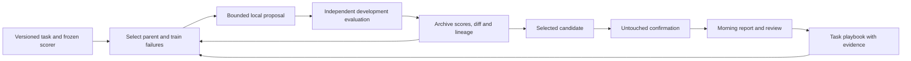

<!-- Generated from the Obsidian vault (Machine/Research). Edit the vault note, not this file: mirror_research.py overwrites it. -->

# Blueprint: make the suite improve through measured local work

> **TL;DR:** Recommends building on evolve-lab with a DGM, GEPA and ACE splice and a frozen scorer, defaulting to a 4-bit 8-12B local model on the 3080.
> **Source:** Synthesis of the resumed 2026-10-24 self-improving AI research and the independent hardware assessment  ·  **Project:** evolve-lab  ·  **Updated:** 2026-10-27

## Decision

Build on **evolve-lab** rather than creating a competing orchestration project. Use a DGM-style artifact/lineage archive, GEPA-style failure feedback and complementary candidates, ACE-style task playbooks, and small verified SFT later. Treat HGM as an optional strategy to test on binary coding tasks. Keep controller permissions, quotas and evaluation rules outside the candidate's editable area. This is my recommended splice, based on the five linked research notes; it is not a benchmarked implementation of all four methods.

The hardware default is a 4-bit 8–12B model that fits the 3080 at the workflow's actual context length. Keep Gemma 12B for the currently scored extraction task; benchmark Qwen 9B, Rnj-1 8B and then Ministral 8B for coding. Full DeepSeek with SSD streaming is an experimental branch, not the default nightly worker. See 2026-10-24 Independent local model and NVMe assessment.

## The loop and its durable artifacts

Suggested experiment fields: `run_id`, parent/variant IDs, task/data/scorer hashes, model digest, prompt/scaffold/diff, configuration, case IDs and per-case outcomes, token counts, timing, invalid outputs, resource measurements and promotion status. These are proposed machine-side fields, not changes to Human note templates.

| Owner goal | First scored task | Useful mutable component | Independent success check |
|---|---|---|---|
| Trading information | Tickers, event type and evidence extraction | Prompt, parser, retrieval settings | Audited labels and source-span support |
| Trading decisions later | Timestamped signal/risk proposal | Signal configuration and evidence policy | Chronological net results and risk invariants; execution remains guarded |
| Coding/repo build-out | Small patch tasks | Context selection, edit format, retry policy | Fixed independent tests and regressions |
| Local-business sites | Business record and factual demo | Extraction/lead qualification and generation prompt | Verified identity/contact facts and owner review |
| Content | One sourced niche pilot | Script outline, captions and render settings | Fact/provenance audit, then approved audience feedback |
| General tooling | Reusable procedural skill | Task playbook and tested helper | Repeated task completion with less time/context |

## What was implemented in this session

- `evolve-lab` now accepts `--proposer ollama:MODEL`. It uses a loopback endpoint, rejects reported remote/cloud aliases and never falls back to a hosted CLI. Output is capped at 1536 tokens; local prompts use a smaller failure sample and 4K context. The brief requests minimal edits rather than wholesale rewrites.
- `--no-holdout` prevents loading/scoring holdout examples for that search. Reports now describe scores as evidence with answer-key/caching limitations rather than asserting guaranteed generalization.
- Tonight's queue retains data refresh, replaces **22 Claude proposals** with **four local Gemma 12B attempts**, and compares models on **train**, not holdout. The cap is four total proposal attempts. No new overnight job type was added.
- **18 offline tests and Ruff pass.** Tests cover bounded local routing, no hosted fallback, remote aliases, holdout exclusion and nightly budget handling. Queue command construction was checked without launching inference; a sampled local brief was 8,688 bytes.
- Live GPU/Ollama inference was blocked by this session's sandbox. These code paths are ready for a bounded trial, but no local-proposer improvement or new model speed is claimed. The existing timer was not verified through systemd in this session; only its queue was changed.

## Step-by-step build sequence

### Now through the next two days: trust and instrumentation

1. Review the 30-label spot-check in 2026-10-24 evolve-lab answer key spot-check. Keep wrong-label repair separate from prompt gains, version it, and re-score comparable variants. Split future data by related document/event as well as time where appropriate.
2. Review the first local proposal run. Record proposal parsing failures, changed rules, train gains, runtime and whether anything hit context/output limits. If the proposer cannot fit the brief or produce useful edits, shorten evidence before increasing GPU context.
3. Add explicit model/input/output token and wall-time records; distinguish batch throughput from request latency. Preserve frozen run manifests so a result can be repeated.
4. Add a small code-repair development task and unseen confirmation set, then benchmark the coding shortlist. Do not select a coding model using the financial extraction leaderboard.

### Days 3–7: improve the search without expensive scale

5. Extend feedback from one scalar to ticker/sentiment/event or test-failure components. Implement bounded exact-text patch proposals and store the diff. Keep an equal-budget broad-rewrite baseline for comparison.
6. Use existing per-example scores to retain a small set of complementary candidates. Compare against mean-score selection with fixed seeds and equal metric calls. Promote only if unseen confirmation gains survive.
7. Try tiny few-shot demo sets from optimization data only. Run two sequential logical islands if evidence shows diversity is being lost. A full DSPy/OpenEvolve migration is not required for these first changes. See [02 Prompt and program evolution](02-prompt-and-program-evolution.md).
8. Create a machine-side active playbook with entry IDs/evidence, leaving FINDINGS append-only. Retrieve relevant entries rather than loading the entire history. See [04 Agent memory, reflection and open-endedness](04-agent-memory-reflection-and-open-endedness.md).

### Week 2: tools/code and useful business work

9. Add a generated-code sandbox around pure parsing/normalization functions. Freeze the evaluator separately, validate import/runtime behavior and test limits before nightly use. Measure whether OpenEvolve/ShinkaEvolve adds value through an adapter.
10. Test an optional HGM selector on binary code tasks under equal budgets. Do not relabel the existing maximum-descendant heuristic as the paper's algorithm. See [01 DGM family deep dive](01-dgm-family-deep-dive.md).
11. Turn site-foundry's unverified-business problem into an audited task: distinguish “no OSM website tag” from “verified no website.” Prepare a small number of factual demos for review and measure total labor. Do not optimize outreach volume before contact accuracy and offer quality.

### Weeks 3–4, only after the data is ready

12. Create `finetune-lab` when there are enough audited, diverse successes to justify training. Start with a 2B environment smoke test and then short-sequence 4B QLoRA. Calibrate 20–50 steps, measure peak memory and estimate duration from the actual run. Compare adapter and quantized export against the frozen base. See [03 Weight-based self-improvement on a 3080](03-weight-based-self-improvement-on-a-3080.md).
13. Add chronological market tasks and forward observation logs. Daily prices/RSS cannot validate an options fill simulator. Keep the options bot on hold and retain the paper-trading gate before considering live work. See [05 Applying it - trading, coding, money](05-applying-it-trading-coding-money.md).
14. Prepare one sourced content pilot only if its niche/offer is clear. Audience response and customer acceptance must be gathered through owner-approved external activity; a self-judge cannot supply that ground truth.

These dates describe a sequence of readiness gates, not a promise to complete uncertain work in a fixed number of days. Advance when the evidence supports it.

## Quotas and overnight autonomy

Default overnight hosted proposal budget: **zero**, with any hosted review explicitly budgeted during the day. Count local proposals, model evaluations, wall time and useful survivors separately. Start with one loaded GPU model and short context; sequential work can be more useful than competing models that spill to RAM. An NVMe is useful storage/I/O infrastructure, not additional VRAM.

Safe current unattended scope is prompt-only local proposals, local comparisons and the already authorized collector job. General self-editing code, training and external publishing are not added to the current queue. Before widening execution, keep an external supervisor with validated process/resource limits, read-only scorer, restricted mounts/network, checkpoints and the stop file. A nightly report should distinguish skipped/failed work from a completed experiment and state whether any hosted calls occurred.

## Research boundaries and next evidence

All five companion reports cite primary papers or provider documentation. Headline paper gains were not reproduced here. Exact costs and memory fits are marked unverified where sources or live measurements do not establish them; Instagram policy retrieval was blocked. The prioritized next evidence is the label audit, local proposer trial and coding-task benchmark. Those determine whether the system is improving in a way that matters, before adding more methods or larger models.
